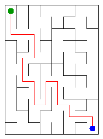

HEAD
# Assignment 3. Maze Escape

Student ID: 252678
Name:Inzhu Abdirasul
Group:SE-2512
Maze size (rows x columns):

This project implements a maze using Disjoint Set Union (DSU), Kruskal's algorithm, Prim's algorithm, DFS, Kosaraju's algorithm, and a route algorithm on a directed acyclic graph (DAG)

## Program output

The 13 lines your program prints on your data (`java -cp out Main`):

    Broken:87
    Kept:70
    Last broken wall:127
    MST cost:27238
    Heaviest broken wall:853
    Path length:23
    DFS visited:67
    Dead ends:29
    Zones:88
    Largest zone:1
    Is DAG:1
    Flow stages:16
    Fastest route cost:17

My maze:file:///C:/Users/user/Downloads/maze-escape-starter%20A3w7/maze-escape/output/maze.html

## Questions

Mission 0. What do find and union do, and what makes them fast in your code?
find(x) finds the leader of the group containing cell x. union(a, b) joins two different groups and returns true. If the cells are already in the same group, it returns false. My DSU uses union by size, so the smaller group joins the larger group. It also uses path compression (path halving) to make future find operations faster.

Mission 1. Why is Broken always R*C - 1, and Kept always (R-1)*(C-1)?
There are R*C cells. The maze must connect all cells without cycles, so it is a tree. A tree with N vertices has exactly N-1 edges. That is why the program breaks R*C - 1 walls.

Mission 2. My MST cost from Kruskal and from Prim, and why they are equal:
The MST cost reported by Kruskal is 27238. Prim should also return 27238 for the same connected graph; this should be confirmed by running the program or its tests. Kruskal sorts the walls by cost and uses DSU to avoid cycles. Prim starts from one cell and uses a priority queue to choose the cheapest edge to a new cell. Both algorithms find an MST, so their total costs are equal.

Mission 3. Why is there exactly one path between two cells? How did you avoid a stack overflow on a huge maze?
Mission 1 makes a connected maze without cycles, so the maze is a tree. In a tree, there is exactly one simple path between any two cells. I use iterative DFS with arrays as a stack instead of recursive DFS. This avoids a deep Java call stack and helps prevent StackOverflowError in a large maze. DFS checks directions in this order: up, right, down, left.

Mission 4. Why does the second pass of Kosaraju go on the reversed graph? Why do the slides have no cycle exactly when Zones equals the number of cells?
Kosaraju uses two DFS passes. The first pass records the order in which vertices finish. The second pass processes vertices in reverse finishing order on the reversed graph. This helps find each strongly connected component without mixing different components.

A directed cycle of two or more cells would put those cells in the same SCC. The input also has no slides from a cell to itself. So, if every cell is its own zone, there are no directed cycles and the slides graph is a DAG. My result is 88 zones for 88 cells, so Is DAG is 1.

Mission 5. Why is it enough to go through the zones in the order of their numbers? What does this pass cost?
After Kosaraju, each SCC becomes one zone. The graph of zones has no directed cycles, and the zone numbers are in topological order. This means an edge between different zones goes from an earlier zone to a later one. I can process zones in number order to update the longest chain and the shortest travel time.

In my current routes() code, I scan all S slides for each of the Z zones. The two passes therefore take O(Z*S) time and use O(Z) extra space, not counting the input and zoneOf array. A version with adjacency lists for the zone graph could run in O(Z+S) time.

## AI use

I used ChatGPT to understand the assignment, learn about the algorithms, and prepare this report. I checked the program output and reviewed the explanations.

## ## Timing (Mission 7)

Milliseconds, 5 runs each, with the average time.

| Maze | Kruskal | Prim |
|---|---:|---:|
| 100 x 100 | 18 | 17 |
| 300 x 300 | 93 | 108 |
| 1000 x 1000 | 1194 | 1877 |
Kruskal is faster for the 300 x 300 and 1000 x 1000 mazes. Prim is slightly faster for the 100 x 100 maze. For the largest maze, Kruskal takes 1194 ms, while Prim takes 1877 ms
## Complexity

| algorithm | time | space | assumptions |
|---|---|---|---|
| DSU find and union | Almost O(1) per operation | O(n) | Uses path compression and union by size |
| Kruskal | O(m log m) | O(n + m) | Sorts edges by weight and uses DSU |
| Prim | O(m log n) | O(n + m) | Uses a priority queue and adjacency lists |
| DFS | O(n + m) | O(n + m) | Uses an iterative search |
| Kosaraju | O(n + m) | O(n + m) | Uses two DFS passes |
| Route in the zone graph | O(Z + E) | O(Z + E) | The zone graph is a DAG and uses topological order |
## Before you submit

- data/walls.txt, data/slides.txt and output/maze.png are in the repository.
- `java tools/Check.java` shows all examples right.
- This README is filled in, the program output and the section AI use included.
- The work is pushed to main (at least one commit per mission) and the repository is public.
- The link is attached in Moodle.

# daa3
 9218cbd24d5ceb4539e19c7097e4384e616a1a7a
